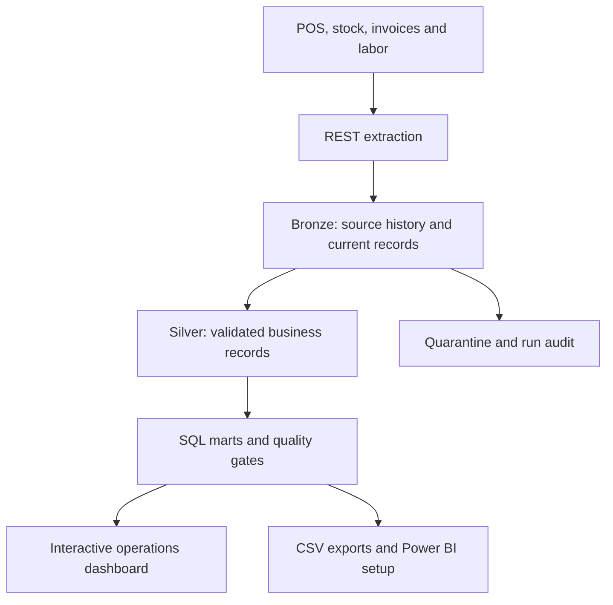

# Restaurant Operations Platform


[](https://github.com/minhajulsimon-beep/restaurant-operations-platform/actions/workflows/ci.yml)


### Live Dashboard

[View Interactive Restaurant Operations Dashboard](https://minhajulsimon-beep.github.io/restaurant-operations-platform/)

Explore sales performance, food costs, labor expenses,
inventory variance, and financial reconciliation
across three fictional restaurant locations.


A small, reproducible data platform for a restaurant group. It brings POS sales, payments, refunds, stock counts, purchasing and hourly labor into one SQL warehouse, then turns them into daily operations and reconciliation reports.

The business question is straightforward: **How much did each location sell, what did food and labor cost, and which records need attention before the numbers can be trusted?**

The project runs with **Python 3.11+ and its standard library**. No database server, pip install, API key or cloud subscription is required for the demo.

## Start here

Download or clone this repository, open a terminal in its folder, and run:

```bash
python run.py demo
python run.py test
python run.py dashboard
```

If your computer uses `python3` or Windows `py`, use that command instead of `python`. The first command creates the source files, starts a local REST simulator, extracts every page, builds the warehouse and generates reports. The local API stops when extraction finishes.

Open `data/demo/reports/dashboard.html` in a browser. A prebuilt **three-location** example is already included at [examples/dashboard.html](examples/dashboard.html); download the file or open it locally, because GitHub's file viewer does not execute HTML. The default runnable demo starts with **one location**.

For a plain-language explanation of every step, read [the walkthrough](docs/walkthrough.md). [Git and GitHub instructions](docs/github_steps.md) explain how to publish your copy and run it in a browser-based Codespace.

## What is implemented

| Area | Working implementation |
| --- | --- |
| REST extraction | Local authenticated source API, pagination, bounded retries, timeouts and simulated rate limiting |
| Source data | Deterministic sales lines, split-payment-compatible tender events, refunds, receiving, invoices, inventory counts, labor and waste |
| Warehouse | SQLite database, typed clean tables, common dimensions, SQL reporting marts and grain constraints |
| Incremental behavior | Per-source modification watermarks, a seven-day overlap, version-aware upserts and retained source history |
| Reconciliation | Check-to-payment comparisons, financial refund controls, authoritative SKU/pack mapping, invoice-to-receipt comparisons |
| Food and labor | Recipe usage, physical inventory usage, recorded waste, unexplained variance and loaded hourly labor |
| Reporting | Offline interactive dashboard, location/date filters, CSV exports and a Power BI setup kit |
| Reliability | Quarantine, run logs, quality gates, transactional rollback and independent integration tests |
| Automation | GitHub Actions CI and a manually triggered synthetic reporting workflow; optional schedule is commented out |
| Toast extension | Separate read-only raw-order extractor with mocked tests; live access and warehouse normalization are not completed |

**Scope:** This is a working portfolio implementation using fictional data. It is not a deployed restaurant system. The dashboard is HTML; the Power BI folder contains M queries, DAX, relationships, a theme and report instructions, not a Desktop-tested `.pbix`. The Azure/Databricks path is a documented future migration, not a provisioned service.

## How data moves



Extraction is incremental. Silver and gold tables are rebuilt from the current raw records inside a single database transaction. This is a deliberate small-data design: it handles old-date corrections simply and makes the SQL easy to inspect. It is not a claim of distributed or large-scale execution.

## Demo results

With seed 42, September 1–30, 2026, and one location:

| Result | Value |
| --- | ---: |
| Source rows read on the first load | 3,012 |
| Net sales, excluding tax and tips | $18,890.59 |
| Food usage at standard cost | $2,858.80 |
| Loaded hourly labor | $10,342.06 |
| Operating contribution before overhead | $5,689.73 |
| POS collection shortfall | $16.19 |
| Invoice lines requiring review | 2 |
| Quarantined source records | 1 |

These are **synthetic test results**, not outcomes from a client engagement. Running the same seed reproduces the business data; run IDs and extraction timestamps naturally change.

The intentionally inconsistent records are described in the generated `data/demo/sources/manifest.json`. The run returns `SUCCEEDED_WITH_WARNINGS` because it surfaces those issues. A successful run means the controls completed; it does not mean every business record reconciled.

## Financial choices that matter

- **Tax and tips are not sales revenue.** They are included when checking customer collections.
- **Refunds belong to their posting business date.** A financial-only refund does not put ingredients back into stock.
- **Receiving and supplier billing are separate.** Receipts affect stock; invoice differences trigger review. Purchasing is not deducted again after food consumption is costed.
- **Food usage is physical.** Opening inventory + receipts − closing inventory is compared with recipe usage and recorded waste.
- **Missing counts do not become zero cost.** Incomplete inventory suppresses food cost and contribution for the affected selection.
- **Contribution is not net profit.** Rent, utilities, depreciation, card fees and other overhead are excluded.
- **Facts are aggregated before they are joined.** This prevents an order's multiple items and payments from multiplying revenue.

Definitions and worked examples are in [metrics.md](docs/metrics.md).

## Commands

| Command | Purpose |
| --- | --- |
| `python run.py demo` | Regenerate the same synthetic scenario and run the full pipeline |
| `python run.py run` | Ingest the existing sources incrementally and refresh reports |
| `python run.py run --full-refresh` | Reread all available source events, including older corrections |
| `python run.py test` | Run the full unit and integration suite |
| `python run.py report` | Rebuild exports/dashboard from the committed warehouse |
| `python run.py dashboard` | Open the generated HTML file |
| `python run.py serve` | Serve reports locally at port 8000 |

To demonstrate three locations without changing the single-location workspace:

```bash
python run.py demo --locations 3 --workspace data/multi-location
python run.py dashboard --workspace data/multi-location
```

To inspect the warehouse with real SQL:

```bash
python run.py query --sql "SELECT business_date, net_sales_cents / 100.0 AS net_sales_usd FROM mart_daily_location ORDER BY business_date LIMIT 5"
```

More examples are in [sql/003_analysis.sql](sql/003_analysis.sql). The query command opens the database read-only.

`demo` regenerates synthetic source files. Use `run` after editing an existing source to test a correction, and give the edited record a later `source_updated_at`. Use a separate workspace if you change the seed, dates, duration or location count. Deleting an exported source row is not a supported warehouse deletion signal; full refresh replays events rather than inferring tombstones.

## Repository map

| Path | What to read or run |
| --- | --- |
| `run.py` | Entry point for all everyday commands |
| `restaurant_platform/sources.py` | Deterministic fictional source generation |
| `restaurant_platform/api.py` | REST simulator and extraction client |
| `restaurant_platform/pipeline.py` | Incremental loading, validation, quality and report publication |
| `sql/001_schema.sql` | Warehouse tables and constraints |
| `sql/002_marts.sql` | Sales, payment, invoice and inventory calculations |
| `sql/003_analysis.sql` | Useful investigation queries |
| `restaurant_platform/reporting.py` | Reads published marts and builds offline HTML |
| `reporting/` | Dashboard template and Power BI setup kit |
| `connectors/toast_readonly.py` | Separate raw Toast extraction scaffold |
| `tests/` | Hand-calculated accounting, source/API, reporting and adapter tests |
| `examples/` | Generated three-location report and CSV snapshot |
| `docs/` | Walkthrough, assumptions, Git steps, Power BI and deployment notes |
| `.github/workflows/` | CI and optional synthetic refresh workflow |

Generated working files live under `data/` and are ignored by Git. Do not commit live credentials, payroll, payment details or real source exports.

## Power BI

Follow [docs/power_bi.md](docs/power_bi.md). The kit imports the same published CSV marts used by the dashboard, defines date/location relationships, and provides measures such as Net Sales, Food Cost %, Labor Cost %, Operating Contribution and exception counts. It preserves blank costs when inventory is incomplete and calculates ratios from totals.

Power BI Desktop import/visual behavior still needs to be validated in Desktop. No `.pbix` is included. The HTML report is the immediately runnable dashboard.

## Tests and operations

The tests use small independent fixtures to check expected money and quantities. They cover split payments, refunds, duplicate loads, source changes, invoice errors, missing counts, REST retries, same-version conflicts, and rollback after both extraction and financial-quality failures. They do not assert hard-coded generated demo totals in place of business logic.

Inspect `pipeline_runs`, `quality_results` and `quarantine` when investigating a refresh. The source watermarks only commit after the new warehouse passes fatal quality checks. Export runs after that database commit, so `python run.py report` is the recovery command for a failed report step. [Architecture](docs/architecture.md) explains the boundaries.

GitHub Actions runs tests and one- and three-location demos on Python 3.11, 3.12 and 3.13 when uploaded. Local verification was performed on Python 3.12; hosted CI has not run until the repository is pushed. The optional scheduled workflow is disabled initially and does not provide persistent production storage.

## Next work before a live rollout

Authorized source access and actual schema samples; a tested Toast normalizer; settlement and bank feeds; effective-dated recipes/costs; complete payroll rules; source freshness/completeness contracts; managed secrets and access controls; durable orchestration/checkpoints; backups and monitoring; location-level report security; and sign-off against closed restaurant days.

See [production readiness](docs/production_readiness.md), [Toast integration](docs/toast_integration.md), and [the optional cloud path](docs/cloud_path.md). The [interview notes](docs/interview_notes.md) explain how to discuss what is implemented and what remains.

## License

MIT. All supplied restaurant, workforce and transaction data is fictional.
