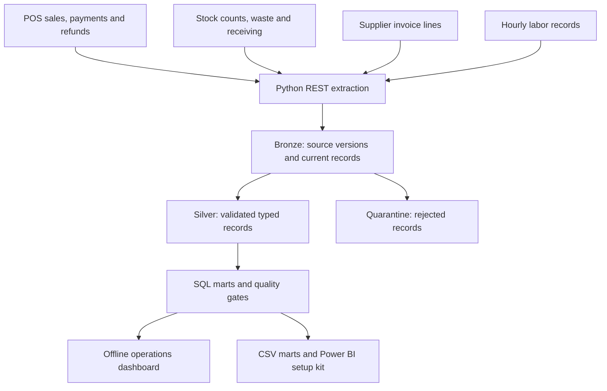

# Architecture and data model

## Data flow

The local REST API is a simulator for this project's own flat data contract. It is not Toast's native API. The standalone Toast extractor writes native raw orders separately; normalization into this warehouse remains a documented integration task.

## Layers

| Layer | Tables | Responsibility |
| --- | --- | --- |
| Source evidence | `bronze_events` | Unique observed source versions, including old versions |
| Current raw state | `bronze_records` | Latest modified version for each source/location/ID |
| Accepted facts | Eight `silver_*` tables | Field types, valid IDs, financial checks, current state |
| Reference data | Location, date, ingredient, menu, recipe and vendor SKU tables | Shared definitions and unit mappings |
| Reporting | Four `mart_*` tables | Pre-aggregated operational and exception reporting |
| Operations | `pipeline_runs`, `quality_results`, `watermarks`, `quarantine` | Execution history, checkpoints and investigation |

## Reporting grains

One row's meaning is its **grain**. Every join should preserve the intended grain.

| Table | One row represents | Business key |
| --- | --- | --- |
| `mart_daily_location` | One location on one business date | location_id + business_date |
| `mart_inventory_variance` | One ingredient at one location on one date | location_id + business_date + ingredient_id |
| `mart_payment_reconciliation` | One order's movements at one location on one date | location_id + business_date + order_id |
| `mart_invoice_reconciliation` | One supplier invoice line at one location | location_id + invoice_line_id |

Each mart has a unique index for that grain. Power BI uses shared location and date dimensions, with single-direction one-to-many relationships. Facts are not joined directly to facts in the semantic model.

## Why aggregate before joining?

An order can have three menu lines and two payment events. A direct join produces six rows. Summing the resulting amounts duplicates both food and payments. The SQL first aggregates sales, refunds, payments, inventory and labor independently, then joins their location/date totals. The payment mart also resolves the order/date grain before comparison. See the split-payment test for a small hand-calculated example.

## Incremental extraction and repeatability

1. Read a per-source modification watermark.
2. Start extraction seven days before that timestamp; a fixed exclusive run-start boundary closes the window.
3. Read every API page, with bounded retries for transient failures.
4. Store each unique source version by source/location/ID/timestamp/hash.
5. Update the current raw row only when its modification timestamp is newer.
6. Rebuild the small current silver and gold snapshots.
7. Run quality gates and commit the warehouse and watermarks together.

Exact duplicates cause no duplicate business activity. Conflicting payloads with the same source version fail the run, including contradictions to an older retained version. Old business dates can be corrected by new modification timestamps. The seven-day overlap handles some out-of-order availability, but cannot recover arbitrarily late delivery with an old modification timestamp. `--full-refresh` rereads all available source events for that case.

`--full-refresh` is an event replay, not snapshot replacement. Removing a line from an export does not delete an already ingested event. A production integration needs explicit tombstones or supported void/cancel states for source deletions.

## Atomicity and failure boundaries

The database uses an explicit SQLite transaction for current facts, retained versions, marts, checks and watermarks. A failed API call, source-version conflict or fatal financial invariant rolls back the transaction. A separate failed run record remains visible. Invalid individual business records are quarantined and the run publishes with warnings. Those warnings are a deliberate demo policy; a real business should choose blocking thresholds.

Reports are built in a staging directory after the database commits, then swapped into place. A Python-level export error leaves the old report directory intact and `python run.py report` can retry. The two-directory rename is not a crash-proof transaction across the database and filesystem; a host crash at the swap boundary may require report regeneration. One process at a time should refresh a workspace. This is a local single-writer design.

## Expansion path

`python run.py demo --locations 3 --workspace data/multi-location` runs the identical code for three locations. Shared mappings and explicit location keys demonstrate logical expansion; they do not establish production throughput. Azure storage, Databricks/Delta, managed orchestration and Power BI service are an optional future design in [cloud_path.md](cloud_path.md). No cloud resources are provisioned.

### Sources

- [SQLite transactions](https://www.sqlite.org/lang_transaction.html)
- [SQLite atomic commit](https://www.sqlite.org/atomiccommit.html)
- [SQLite exact integers and approximate floating point](https://www.sqlite.org/floatingpoint.html)
- [Power BI star-schema guidance](https://learn.microsoft.com/en-us/power-bi/guidance/star-schema)
